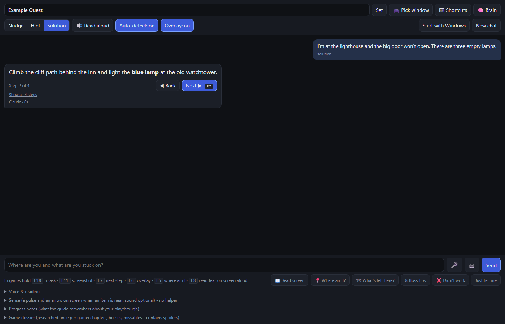
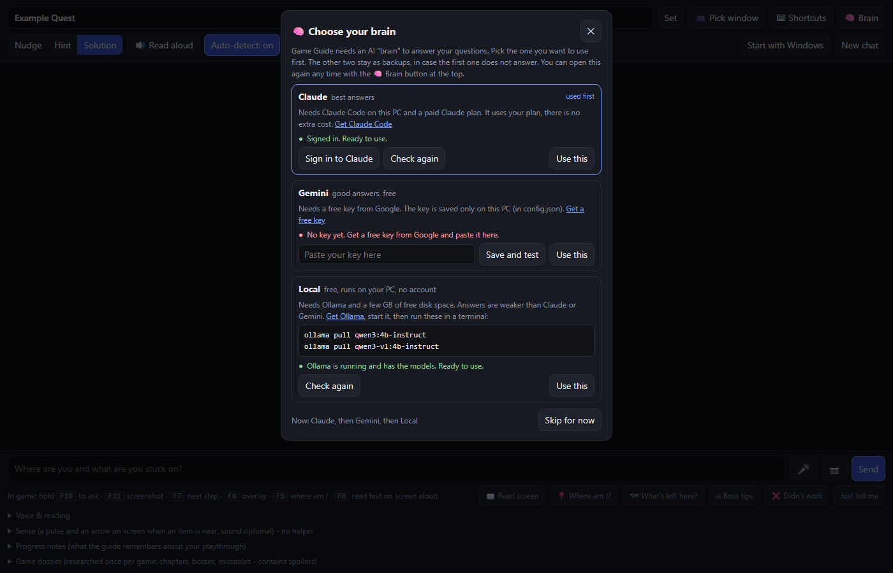

# Game Guide

Stuck in a game? Hold a key, ask out loud (or type), and Game Guide looks up real walkthroughs
(IGN, PowerPyx, Fextralife, wikis, Reddit and more) and tells you where to go, step by step, with sources.
It can also read your screenshots, circle the right button on them, read in-game text out loud and
show the current step on top of the game.

Windows only. Runs on your own PC: a small local web server (127.0.0.1) and an app window.

## What it looks like
An answer, shown one step at a time (Next / Back, or F7 in game):



The "Choose your brain" panel, which opens on the first start:



(Screenshots use a made-up game and made-up answers.)

## What you need
- Windows 10 or 11.
- Python 3.12 (64-bit) from python.org, with tkinter (the default install has it).
- Microsoft Edge (used as the app window; without it the default browser opens instead).
- Windows OCR for English (normally already there; Settings > Time & language > Language).
- At least one "brain" (see below).
- For voice input on the GPU: an NVIDIA card. Without one, set `"whisper_device": "cpu"` in `config.json`.

## Setup
1. Download or clone this folder to any place you like.
2. Install the Python packages. Best in a "venv" inside this folder, so your normal Python stays as it is.
   Open a terminal in this folder and run:
   ```
   py -3.12 -m venv .venv
   .venv\Scripts\python -m pip install -r requirements.txt
   ```
   `Start-GameGuide.bat` and `install.ps1` use this `.venv` by themselves when it is there.
   (Without a venv, `py -m pip install -r requirements.txt` installs into your normal Python; that works too.)
   This includes NVIDIA's CUDA files for voice input on the GPU (about 1 GB). If Game Guide can't start,
   it shows a message that says what is missing.
3. Set up at least one brain. On the first start the window shows a "Choose your brain" panel that helps
   with this (see below).
4. Optional: run `install.ps1` (right-click > Run with PowerShell) to get a desktop and Start Menu shortcut
   and an entry in Settings > Apps. No admin rights needed. Run it again if you move the folder.

## Run
- Double-click `Start-GameGuide.bat` (or the "Game Guide" shortcut). It uses the `.venv` in this folder
  when there is one, else it finds Python through the `py` launcher or your PATH.
- It sits in the tray (by the clock): right-click for Open / Start with Windows / Quit.
- Pick your game: **Auto-detect** (Steam games are named from Steam's own files), **Pick window**, type the
  name, or type a Steam App ID.

## Hotkeys (in game)
| key | what it does |
|---|---|
| hold **F10** | talk; let go to send your question |
| **F11** | screenshot, added to your next question (use borderless fullscreen) |
| **F8** | read the text on screen out loud (notes, letters, subtitles); F8 again stops |
| **F7** | next step (window, overlay and voice together) |
| **F6** | show / hide the in-game overlay |
| **F4** | "Where am I?": where you are, your goal right now, what to do next |

Keys can be changed in `config.json` (`hotkey_talk`, `hotkey_screenshot`, `hotkey_read`, `hotkey_next`,
`hotkey_overlay`, `hotkey_where`). The overlay needs borderless or windowed fullscreen.

Other things in the window: Nudge / Hint / Solution (how much it gives away), Boss tips, "Didn't work"
(tries the steps again more carefully), Read aloud, Progress notes, and a Game dossier that the guide
builds once per game in the background.

## The 3 brains
Game Guide tries the brains in the order of `"brain_order"` in `config.json`
(default `["claude", "gemini", "local"]`). If one is missing or fails, it moves to the next.

**Choose your brain panel.** On the first start the window shows one card per brain, each with a live status:
- Claude: is Claude Code installed, and are you signed in? (It asks `claude auth status`; no question is sent.)
  **Sign in to Claude** opens the same sign-in window as `Login-Claude.bat`, only when you press it.
- Gemini: paste your free key and press **Save and test**. The key is saved only in your own `config.json`.
- Local: is Ollama running on this PC, and does it have the models? It shows the download link and the
  `ollama pull` commands to run.

**Use this** puts that brain first and keeps the other two as backups. **Skip for now** closes the panel.
Open it again any time with the **🧠 Brain** button at the top of the window. Nothing signs in by itself.

| brain | cost | needs | notes |
|---|---|---|---|
| `claude` | part of your Claude subscription | Claude Code installed + logged in | best answers; run `Login-Claude.bat` once to log in |
| `gemini` | free API key | a key from Google AI Studio in `"gemini_api_key"` (or the `GEMINI_API_KEY` environment variable) | very good |
| `local` | free | [Ollama](https://ollama.com) with `ollama pull qwen3:4b-instruct` (and `qwen3-vl:4b-instruct` for screenshots) | uses about 2.5 GB of GPU memory, unloads after 2 minutes |

The Claude brain runs the Claude Code CLI in the background with only WebSearch, WebFetch and Read allowed
(Read is how it looks at your screenshots). Your Claude Code plugins are switched off for these runs.
The local brain searches with DuckDuckGo and reads the guide pages itself.

## Settings (`config.json`)
`config.json` is made on the first start with plain defaults. `config.example.json` shows the common keys.
A few useful ones:
- `whisper_device`: `"cuda"` (NVIDIA GPU) or `"cpu"`.
- `speak_answers`, `voice`, `voice_rate`: reading answers out loud. Voices are Microsoft's online neural
  voices (through edge-tts, free, no key).
- `kokoro_models_dir`: folder for the offline voice that is used when the online voice fails. Put
  `kokoro-v1.0.onnx` and `voices-v1.0.bin` (from the kokoro-onnx releases on GitHub) there. Empty = a
  `models` folder next to `guide.py`.
- `extra_vocab_file`: optional text file with extra words (names) for speech recognition, comma separated.
- `sense_game_dirs`: game folders for the Sense helper (see below).

## Sense (optional, experimental)
Sense plays a soft sound and shows a pulse when an item or chest is near, and can draw a dotted path to
your quest target. It needs a small read-only Lua helper mod inside the game, so it only works for the
games that have a profile here:
- Phantom Blade Zero (UE4SS): download "UE4SS For Phantom Blade Zero" (1.0.2) from Nexus Mods yourself
  and put the zip at `sense\downloads\ue4ss-pbz-1.0.2.zip`. If UE4SS is not in the game yet, the installer
  also needs signature files that match your game build in `sense\ue4ss-signatures-pbz\`
  (`GNatives.lua`, `GUObjectArray.lua`); they are not part of this repo.
- RE Engine games (Resident Evil Requiem, Dragon's Dogma 2): install REFramework yourself first.

Then tell Game Guide where the game is, in `config.json`:
```json
"sense_game_dirs": {"phantom-blade-zero": "<your Steam library>/steamapps/common/PBZ/platform/steam"}
```
(the key is the game name in lower case with dashes and without apostrophes: `phantom-blade-zero`,
`resident-evil-requiem`, `dragons-dogma-2`; the value is the folder that holds the game's exe,
for example `PBZ.exe`, `re9.exe` or `DD2.exe`). Write folder paths with `/` (or `\\`): a single `\` makes
`config.json` invalid, and Game Guide then tells you so instead of starting. Restart Game Guide after editing `config.json`. Close the game and press **Install helper** in the Sense panel.
The installer makes a backup in `sense\backup\` first. The game profiles are in `sense\helper\`.

## Your data (stays on your PC)
Everything is kept in this folder and is not part of git (see `.gitignore`):
- `config.json` your settings (and your Gemini key if you add one)
- `games\<game>\` chat history, progress notes, the game dossier, words for speech recognition, screenshots
- `games\games.json` which .exe is which game; `last_game.txt` the last game
  (the empty `games.json` next to `guide.py` is part of the repo: only a starting list, never written)
- `guide.log` the log; `.edge-profile\` the app window's own browser profile
- `sense\backup\`, `sense\downloads\` Sense backups and downloads

Your questions and screenshots go to the brain you use (Claude, Google Gemini, or nothing leaves your PC
with the local brain, apart from the web searches).

## Uninstall
Settings > Apps > Game Guide (or run `uninstall.ps1`). It removes the shortcuts and the autostart;
this folder and your chats stay until you delete it.

## Tests
```
.venv\Scripts\python tests\_run_all.py
```
(or `py tests\_run_all.py` if you installed the packages without a venv)
Runs every `tests\test_*.py` in its own process (pure logic, temp folders only; no window, no game).
Single test: `.venv\Scripts\python tests\test_questpath.py` (or `py tests\test_questpath.py`). Exit code 0 = all passed (for the whole run and for a single test).
The privacy test only looks at the files git would add, so your own settings and data don't make it fail.

## Credits and third-party parts
- [marked](https://github.com/markedjs/marked) (MIT) and [DOMPurify](https://github.com/cure53/DOMPurify)
  (Apache-2.0 / MPL-2.0) are included in `web\` with their license headers; marked's full license text is
  in `web\marked.LICENSE.md`.
- Python packages from `requirements.txt` (faster-whisper, edge-tts, kokoro-onnx, aiohttp, and others) are
  installed by pip and keep their own licenses.
- UE4SS, REFramework, the Nexus UE4SS package and the Kokoro model files are not included; get them from
  their own pages.
- `web\icon.*` is made by `make_icon.py`, and `sense\sounds\*.wav` by `sense\make_sounds.py`.

Built with [Claude Code](https://claude.com/claude-code).

## License
MIT, see [LICENSE](LICENSE).
